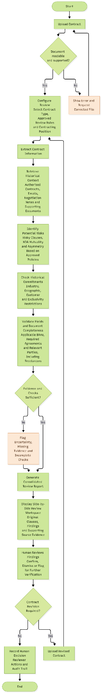

**Contract Risk Analyzer — AI PRD  
**

An AI PRD for AtliQ Technologies

**Table of Content:**  
  
1. PRD Details

2\. Executive Summary

3\. Problem Statement and Background

4\. Opportunity and AI Capability Mapping

5\. Personas and User Stories

6\. Model Strategy

7\. Functional Requirements

8\. Non-Functional Requirements

9\. Behaviour, Output Specification and Workflow

10\. Guardrails and Failure Modes

11\. Eval Criteria

12\. Success Metrics

13\. Scope and MVP Boundary

14\. Rollout and Release Strategy

15\. Timeline and Milestones

16\. Open Questions and Assumptions Log

**PRD Details:  
**

|                  |                                                       |
|------------------|-------------------------------------------------------|
| **Product name** | Contract Risk Analyzer                                |
| **Author**       | Azaruddin Tamboli, AI Product Manager, AI PM Bootcamp |
| **Date**         | 11 October 2026                                       |
| **Version**      | V1.0, Draft                                           |
| **Status**       | Draft for review                                      |

<table>
<colgroup>
<col style="width: 100%" />
</colgroup>
<tbody>
<tr class="odd">
<td><strong>Pain Point: 
</strong>AtliQ Technologies is a founder-led IT services company without an in-house legal team. The CEO, Karandeep must review client and partner contracts thoroughly while managing the business. Reviews require clause-by-clause examination and manual gathering of context from past contracts, emails, chats, negotiation history and business discussions. This increases review time, creates delays in the contract review queue, and raises the risk of overlooking material contractual issues or conflicts with existing commitments.</td>
</tr>
</tbody>
</table>

# **1. Executive Summary**

|                                 |                                                                                                                                                                                                                                                                                                                               |
|---------------------------------|-------------------------------------------------------------------------------------------------------------------------------------------------------------------------------------------------------------------------------------------------------------------------------------------------------------------------------|
| **What are we building?**       | An AI-assisted Contract Risk Analyzer that extracts key contract terms, identifies potentially risky clauses, retrieves relevant historical commitments, checks document completeness and generates an evidence-based review report.                                                                                          |
| **Why does it matter?**         | Contract reviews currently require manual reading and information gathering across fragmented sources. The solution aims to reduce review effort, improve consistency and help AtliQ identify material risks before making contractual commitments.                                                                           |
| **Who is it for?**              | Primary: CEO, Karandeep, as the contract reviewer and decision-maker. Secondary: Authorised business stakeholders involved in contract review, negotiation and supporting-document validation.                                                                                                                                |
| **How will we know it worked?** | **Proposed North Star:** Median human reviewer time saved per contract compared with the current manual process, provided material-risk detection quality meets agreed evaluation thresholds. The initial aspiration is to support a thorough first-pass review in under five minutes, subject to validation through testing. |
| **Target launch**               | To be determined. Initial milestone: a working capstone prototype evaluated on representative contract examples before any live business deployment.                                                                                                                                                                          |

# **  2. Problem Statement and Background**

AtliQ Technologies is a founder-led IT services company without an in-house legal team. Karandeep, the CEO, is responsible for reviewing and signing contracts while managing other business responsibilities.

Today, contract review involves manually:

- Reading incoming contracts to understand commercial terms, obligations and potential risks.

- Searching signed contracts, emails, negotiation notes and meeting notes for relevant historical commitments.

- Checking clauses against existing commitments, such as exclusivity or non-compete restrictions.

- Verifying contracting entities, governing law, contract completeness and supporting documents.

The challenge is not simply reading a contract. It is finding the right information across fragmented sources, connecting it to the proposed agreement and making an informed decision without overlooking material risks.

## **2.1 Current State**

The process begins when AtliQ receives a contract draft from a client, partner or contractor, or prepares a draft for review.

1.  **Contract received:** The seller or relevant stakeholder receives the contract and shares it for review.

2.  **Contract registered:** The contract is uploaded or recorded, although ownership, tracking and review order may not always be consistently established.

3.  **Historical commitments checked:** Karandeep and relevant stakeholders look for existing commitments that could conflict with the proposed agreement.

4.  **Clauses reviewed:** Contract clauses are read and assessed against the deal context, commercial expectations and relevant reference points.

5.  **Entity and governing law checked:** The contracting parties and applicable governing law are reviewed.

6.  **Documents and data validated:** Required paperwork, supporting documents and relevant data fields are checked for completeness and consistency.

7.  **Commercial fairness assessed:** The reviewer considers whether the terms are acceptable to AtliQ and whether any clauses require clarification or negotiation.

8.  **Findings reviewed:** Potential issues are evaluated, prioritised and discussed with the relevant stakeholders.

9.  **Negotiation and re-review:** Material points are negotiated, the draft is updated and changed terms are reviewed again.

10. **Final decision recorded:** An authorised person approves or rejects the contract, arranges signing where appropriate and records the decision and its rationale.

## **2.2 Pain Points **

- Fragmented information: Relevant commitments and negotiation history are spread across contracts, emails, meeting notes and other documents.

- Risk of missed commitments: Existing obligations, including exclusivity or non-compete restrictions, may be overlooked when reviewing a new agreement.

- Manual review effort: Reading clauses, locating supporting evidence and cross-checking historical records consume valuable management time.

- Inconsistent review: The thoroughness and prioritisation of findings may vary depending on the contract's complexity and the information available.

- Unclear evidence and completeness: It can be difficult to establish whether a potential conflict is supported by a valid agreement, whether a document is missing or whether a clause needs further clarification.

## **2.3 Business Impact and Why Now**

The current process places contract review responsibility on the CEO while requiring information to be gathered from multiple sources. This creates an opportunity cost for leadership, may delay contract decisions and increases the possibility that material contractual risks or existing commitments are overlooked.

The opportunity is to make relevant contract information easier to find, compare and verify before a decision is made. Advances in document extraction, retrieval-augmented generation (RAG), language models and structured rule checks make it feasible to assist with these tasks.

The product should not replace legal judgment or guarantee that every risk will be detected. Its purpose is to improve the speed, consistency and traceability of the first-pass review while keeping the final decision with an authorised human.

**  
2.4 Job To Be Done Framing  
**

Framing the problem as a job to be done (JTBD), rather than a feature request, keeps the team focused on the recruiter's actual goal instead of a list of outputs.

<table>
<colgroup>
<col style="width: 23%" />
<col style="width: 76%" />
</colgroup>
<tbody>
<tr class="odd">
<td><strong>Job to be done</strong></td>
<td><ul>
<li>
<strong>When I receive</strong> a contract from a client, partner or contractor that requires review<strong>,</strong>
</li>
<li>
<strong>Help me</strong> understand the key terms, identify potential risks and conflicts with existing commitments, and find the supporting evidence<strong>,</strong>
</li>
<li>
<strong>So that I can</strong> make an informed contract decision without spending excessive time manually searching and comparing fragmented information.
</li>
</ul></td>
</tr>
<tr class="even">
<td><strong>Trigger</strong></td>
<td>A new contract draft is received or an existing draft is revised and requires review before approval or signing.</td>
</tr>
<tr class="odd">
<td><strong>Outcome</strong></td>
<td>
The reviewer receives a structured summary of key terms, potentially risky clauses, relevant historical commitments, missing documents and recommended points for human verification. Each material finding should include its source evidence.

The initial performance aspiration is to support a thorough first-pass review in under five minutes. This target must be validated against representative contracts and must not compromise risk-detection quality.
</td>
</tr>
<tr class="even">
<td><strong>Why AI is justified</strong></td>
<td>
The task requires extracting and interpreting information from unstructured documents, retrieving relevant historical context, comparing clauses across multiple sources and summarising findings. AI can assist with these information-intensive activities, while deterministic rules can validate required fields and document checks.

Human judgment remains necessary for interpreting legal and commercial context, resolving ambiguous findings, negotiating terms and making the final approval or rejection decision.
</td>
</tr>
</tbody>
</table>

# **3. Opportunity and AI Capability Mapping**

Each opportunity is mapped to a specific AI capability based on the contract review problem it addresses. The objective is to help the reviewer find relevant information, identify potential risks and make informed decisions using traceable evidence.

| Opportunity                                                                                                                                                                                                                                                                                                                                                                                                                                                                                                                                                                                                                          | AI capability used                                                                               |
|--------------------------------------------------------------------------------------------------------------------------------------------------------------------------------------------------------------------------------------------------------------------------------------------------------------------------------------------------------------------------------------------------------------------------------------------------------------------------------------------------------------------------------------------------------------------------------------------------------------------------------------|--------------------------------------------------------------------------------------------------|
| **Contract Understanding and Information Extraction:** Extracts key information from incoming contracts, including contracting parties, contract value, scope, dates, obligations, termination conditions and other important terms. Converts unstructured contract content into structured fields for review.                                                                                                                                                                                                                                                                                                                       | **Document processing, Information Extraction, Classification and LLM-based Generation**         |
| **Historical Context Retrieval:** Retrieves relevant information from previously signed contracts, emails, negotiation notes, meeting notes and supporting documents. Provides source references so the reviewer can verify the information.                                                                                                                                                                                                                                                                                                                                                                                         | **Retrieval-Augmented Generation (RAG), Semantic Search and Information Retrieval**              |
| **Risky Clause Identification:** Identifies clauses that may require attention, including liability, indemnity, payment, intellectual property, termination and other contract-specific risk areas. Explains why each clause may require review and links the finding to the original clause.                                                                                                                                                                                                                                                                                                                                        | **Classification, LLM-based Analysis and Evidence-Grounded Generation**                          |
| **Historical Commitment Conflict Detection:** Identify whether a proposed contract conflicts with previous commitments, such as restrictions on working with specific industries or geographic markets. Example: a prior commitment restricting AtliQ from working with hotel businesses in Dubai.                                                                                                                                                                                                                                                                                                                                   | **RAG, semantic search, information extraction, rule-based comparison**                          |
| **Entity Validation and Document Completeness:** Checks contracting entity names, governing law and required contract fields against approved reference data. Identifies potentially missing agreements, annexures, schedules and supporting documents based on a configurable checklist.                                                                                                                                                                                                                                                                                                                                            | **Rule-Based Validation, Entity Matching, Classification and Document Processing**               |
| **Consolidated Risk Report and Review Support:** Combines extracted contract terms, clause-level risk findings, historical commitment conflicts and document completeness checks into a structured review workspace. Displays the original contract alongside prioritised findings, with severity indicators, supporting evidence, source references and explanations. Allows the reviewer to inspect, confirm, dismiss or flag findings for further verification, while recording unresolved questions and review decisions. The system supports human decision-making and does not autonomously approve, reject or sign contracts. | **LLM-based Summarisation, Structured Output Generation, RAG and Human-in-the-Loop Review**      |
| **NDA Mutuality and Asymmetry Detection:** Identify whether an NDA imposes obligations disproportionately on AtliQ or lacks reciprocal protections, based on AtliQ's approved policies.                                                                                                                                                                                                                                                                                                                                                                                                                                              | **Clause classification, information extraction, LLM-assisted analysis**                         |
| **Required Agreement and Party Checks:** Identify potentially missing required agreements, such as a Business Associate Agreement (BAA) for applicable healthcare projects, including relevant freelancers or other parties.                                                                                                                                                                                                                                                                                                                                                                                                         | **Document classification, entity extraction, configurable rules, document completeness checks** |

# ** 4. Personas and User Stories**

## ** 4.1 User Personas **

<table>
<colgroup>
<col style="width: 26%" />
<col style="width: 73%" />
</colgroup>
<thead>
<tr class="header">
<th>Persona</th>
<th>Description</th>
</tr>
</thead>
<tbody>
<tr class="odd">
<td>Primary: CEO / Contract Reviewer (Karandeep)</td>
<td>
Founder and CEO of AtliQ Technologies who reviews and signs contracts while managing other business responsibilities.

<strong>Goal:</strong> Make informed contract decisions quickly without overlooking material risks or existing commitments.

<strong>Frustration:</strong> Relevant information is scattered across contracts, emails, negotiation notes and other documents, making review time-consuming.
</td>
</tr>
<tr class="even">
<td>Secondary: Business Stakeholder / Contract Submitter</td>
<td>
A seller or business stakeholder who receives or prepares a contract and submits it for review.

<strong>Goal:</strong> Ensure the contract is complete, relevant information is available and potential issues are identified before approval or signing. <strong>Frustration:</strong> Unclear document requirements, repeated information requests and delays while missing context is gathered.
</td>
</tr>
</tbody>
</table>

## ** **

## 

## 

## **4.2 User Stories **

<table>
<colgroup>
<col style="width: 13%" />
<col style="width: 21%" />
<col style="width: 21%" />
<col style="width: 44%" />
</colgroup>
<thead>
<tr class="header">
<th>As a...</th>
<th>I want to...</th>
<th>So that...</th>
<th>Acceptance criteria</th>
</tr>
</thead>
<tbody>
<tr class="odd">
<td>Contract Reviewer</td>
<td><strong>I want to</strong> upload a contract and view its key information,</td>
<td><strong>So that</strong> I can understand the agreement before reviewing its risks.</td>
<td><ul>
<li>
The system extracts key contract fields and displays source references.
</li>
<li>
Missing, ambiguous, or unreadable information is clearly flagged.
</li>
<li>
The system displays upload and processing status.
</li>
</ul></td>
</tr>
<tr class="even">
<td>Contract Reviewer</td>
<td><strong>I want to</strong> search, filter, and access previously uploaded contracts,</td>
<td><strong>So that</strong> I can track ongoing reviews and return to existing contracts.</td>
<td><ul>
<li>
The dashboard lists available contracts and their review status.
</li>
<li>
Users can search and filter by contract name, counterparty, contract type, and status.
</li>
<li>
Users can open an existing contract or initiate a new review.
</li>
</ul></td>
</tr>
<tr class="odd">
<td>Contract Reviewer</td>
<td><strong>I want to</strong> select the contract type and applicable review checklist or playbook,</td>
<td><strong>So that</strong> the review follows the relevant requirements and contracting position.</td>
<td><ul>
<li>
The system displays available review configurations.
</li>
<li>
The reviewer can select the applicable configuration where available.
</li>
<li>
The selected settings are visible before the review starts.
</li>
</ul></td>
</tr>
<tr class="even">
<td>Contract Reviewer</td>
<td><strong>I want to</strong> identify potentially risky clauses with explanations and source references,</td>
<td><strong>So that</strong> I can prioritise issues and verify the AI's findings.</td>
<td><ul>
<li>
Each finding includes the original clause, category, severity, and explanation.
</li>
<li>
Selecting a finding navigates to or highlights the relevant clause.
</li>
<li>
Findings with insufficient evidence or uncertainty are clearly flagged.
</li>
</ul></td>
</tr>
<tr class="odd">
<td>Contract Reviewer</td>
<td><strong>I want to</strong> compare proposed contract terms against relevant historical commitments,</td>
<td><strong>So that</strong> I can identify potential conflicts before committing to a new agreement.</td>
<td><ul>
<li>
The system retrieves relevant historical documents and passages.
</li>
<li>
Potential conflicts show evidence from both the current and historical documents.
</li>
<li>
Historical document status and uncertainty are visible.
</li>
<li>
The system flags possible conflicts without automatically declaring a breach.
</li>
</ul></td>
</tr>
<tr class="even">
<td>Contract Reviewer</td>
<td><strong>I want to</strong> view the contract and AI findings side by side,</td>
<td><strong>So that</strong> I can validate each finding without repeatedly switching between screens.</td>
<td><ul>
<li>
The original contract and prioritised findings are visible in the same workspace.
</li>
<li>
Findings can be filtered by severity and category.
</li>
<li>
Selecting a finding displays its evidence and relevant historical context.
</li>
<li>
Original contract wording is distinguishable from AI-generated explanations.
</li>
</ul></td>
</tr>
<tr class="odd">
<td>Contract Reviewer</td>
<td><strong>I want to</strong> confirm, dismiss, or request verification of individual findings,</td>
<td><strong>So that</strong> I can exercise judgement and maintain control over the review.</td>
<td><ul>
<li>
The reviewer can record an action and optional rationale.
</li>
<li>
Dismissed findings remain available in the audit record.
</li>
<li>
Uncertain or incomplete checks remain visible.
</li>
<li>
Reviewing an individual finding does not automatically approve the contract.
</li>
</ul></td>
</tr>
<tr class="even">
<td>Contract Reviewer</td>
<td>I want to identify missing documents, fields, and inconsistent entity details,</td>
<td>So that I can resolve gaps before making a final decision.</td>
<td><ul>
<li>
Missing documents and required fields are listed.
</li>
<li>
Entity discrepancies and configured governing-law checks are highlighted.
</li>
<li>
Incomplete checks are distinguished from checks that passed.
</li>
</ul></td>
</tr>
<tr class="odd">
<td>Contract Reviewer</td>
<td>I want to generate a report of risks, historical conflicts, validation results, and unresolved questions,</td>
<td>So that I can communicate the review outcome and decide what requires further action.</td>
<td><ul>
<li>
The report includes prioritised findings and supporting evidence.
</li>
<li>
Unresolved questions and incomplete checks are clearly identified.
</li>
<li>
The report reflects the reviewed contract version and recorded reviewer actions.
</li>
</ul></td>
</tr>
<tr class="even">
<td>Contract Reviewer</td>
<td>I want to record the final decision and its rationale,</td>
<td>So that the contract outcome is traceable and accountable.</td>
<td><ul>
<li>
The reviewer can record the decision according to AtliQ's process.
</li>
<li>
The system retains the decision, timestamp, relevant findings, and rationale where provided.
</li>
<li>
The AI does not autonomously approve, reject, or sign a contract.
</li>
</ul></td>
</tr>
</tbody>
</table>

# **5. Model Strategy**

The AtliQ Contract Risk Analyzer will use a hybrid AI approach combining document processing, Retrieval-Augmented Generation (RAG), Large Language Models (LLMs), deterministic rules, and human-in-the-loop review.

The strategy is designed to identify potential contractual risks, retrieve relevant historical commitments, validate contract completeness, and present evidence-backed findings to the authorised reviewer. The system will assist decision-making rather than make autonomous legal or contractual decisions.

**5.1 Document Processing and Information Extraction**

The system will process supported contract documents to extract relevant information, including contracting parties, contract type, scope, contract value, dates, obligations, termination conditions, governing law, and individual clauses.

Extracted information should retain references to the original document and relevant source locations wherever technically feasible. Missing, ambiguous, or unreadable information must be explicitly flagged.

**5.2 Retrieval-Augmented Generation (RAG)**

RAG will retrieve relevant information from authorised historical contracts, negotiation notes, emails, meeting notes, and supporting documents.

Retrieved information will support historical commitment checks, contextual risk analysis, and evidence-backed explanations. Each retrieved item should retain its source reference and document status, such as signed, draft, superseded, or unverified, where that information is available.

The system must not treat every historical document as an active commitment without validating its status and relevance.

**5.3 LLM-Based Contract Analysis**

LLMs will analyse extracted clauses and retrieved context to identify potentially risky terms, explain possible conflicts, and generate a consolidated review summary.

The model should return structured findings containing:

\- Risk category and severity.

\- Original clause text and source location.

\- Explanation of the potential risk.

\- Supporting historical evidence, where relevant.

\- Confidence or uncertainty indicators and unresolved questions.

The model must distinguish between evidence found in source documents and its own interpretation. It must not invent contractual terms, historical commitments, or supporting evidence.

**5.4 Deterministic Rules and Validation**

Rule-based checks will complement LLM analysis for predictable and configurable validations, including required fields, entity details, governing-law checks, and document completeness.

Rules and reference data should be configurable where appropriate. Validation results must distinguish passed checks, failed checks, and checks that could not be completed.

**5.5 Human-in-the-Loop Review**

The AI-generated findings will be presented in a review workspace alongside the original contract text. Reviewers will be able to inspect evidence, confirm or dismiss findings, request further verification, and record comments or rationale.

Human decisions will remain separate from AI-generated findings. The system will not autonomously approve, reject, or sign contracts, nor send contractual amendments without authorised human approval.

**5.6 Model Evaluation and Quality Assurance**

The solution will be evaluated using a representative test dataset containing typical contracts, historical commitment conflicts, risky clauses, incomplete documents, misleading or non-risky clauses, and ambiguous cases.

Evaluation will focus on:

- Material-risk recall: whether important contractual risks are identified.

- Evidence accuracy: whether findings correctly reference the supporting source text.

- Groundedness: whether explanations are supported by available evidence.

- False-positive rate: how often non-material or non-risky clauses are incorrectly flagged.

- Historical conflict detection: whether relevant prior commitments are retrieved and compared correctly.

- Completeness and uncertainty handling: whether missing information and incomplete checks are disclosed.

- Reviewer usability: whether reviewers can efficiently inspect, verify, and act on findings.

Because missing a material risk may be more costly than flagging a questionable clause for human review, evaluation should prioritise material-risk recall while keeping false positives manageable.

**5.7 Model and Technology Selection**

The specific LLM provider, document-processing technology, embedding model, retrieval infrastructure, and vector database will be determined during technical design and prototype evaluation.

Technology selection should consider evidence-grounded output quality, document-format support, security, privacy, latency, cost, scalability, and integration feasibility. No specific model or infrastructure component is assumed to have been selected at this stage.

# **6. Functional Requirements**

<table>
<colgroup>
<col style="width: 8%" />
<col style="width: 61%" />
<col style="width: 15%" />
<col style="width: 15%" />
</colgroup>
<thead>
<tr class="header">
<th>ID</th>
<th>Requirement</th>
<th>Priority</th>
<th>Status</th>
</tr>
</thead>
<tbody>
<tr class="odd">
<td><strong>FR-1</strong></td>
<td>Contract Upload and Validation: Allow users to upload supported contract documents. Validate file type and readability, and clearly flag unsupported, corrupted, or unreadable files.</td>
<td>Must</td>
<td>Open</td>
</tr>
<tr class="even">
<td><strong>FR-2</strong></td>
<td>Contract Information Extraction: Extract key information such as contracting parties, contract type, scope, contract value, dates, obligations, termination conditions, governing law, and other relevant terms. Display source references for extracted information and flag ambiguous or missing fields.</td>
<td>Must</td>
<td>Open</td>
</tr>
<tr class="odd">
<td><strong>FR-3</strong></td>
<td>Contract Dashboard and Search: Provide a dashboard listing uploaded and previously reviewed contracts. Allow users to search and filter by contract name, counterparty, contract type, review status, and upload or update date.</td>
<td>Must</td>
<td>Open</td>
</tr>
<tr class="even">
<td><strong>FR-4</strong></td>
<td>Review Configuration: Allow users to select the contract type, applicable review checklist or playbook, and relevant contracting position where configured. Apply AtliQ-approved rules for checks such as NDA mutuality, healthcare agreement requirements, and applicable party coverage. Display the selected settings before starting the review. Do not assume a universal contract checklist.</td>
<td>Must</td>
<td>Open</td>
</tr>
<tr class="odd">
<td><strong>FR-5</strong></td>
<td>Historical Context Retrieval: Retrieve relevant information from authorised historical contracts, negotiation notes, emails, meeting notes, and supporting documents. Show the source, document status, and relevant passage for each retrieved item. 
Explicitly mention industry and geographic restrictions, such as the prior restriction involving hotel businesses in Dubai.</td>
<td>Must</td>
<td>Open</td>
</tr>
<tr class="even">
<td><strong>FR-6</strong></td>
<td>Risk and Clause Identification: Identify potentially risky clauses, including liability, indemnity, payment, intellectual property, termination, and other configured risk categories. Display the original clause, risk category, severity, explanation, and supporting evidence.</td>
<td>Must</td>
<td>Open</td>
</tr>
<tr class="odd">
<td><strong>FR-7</strong></td>
<td>Historical Commitment Conflict Detection: Compare proposed contract terms against relevant historical commitments, including industry, geographic, customer, exclusivity, or non-compete restrictions. For example, flag a potential conflict if a prior commitment restricts AtliQ from working with hotel businesses in Dubai. Show evidence from both the proposed contract and the relevant historical document, and explain why the terms may conflict without automatically declaring a breach.</td>
<td>Must</td>
<td>Open</td>
</tr>
<tr class="even">
<td><strong>FR-8</strong></td>
<td>Entity Validation and Completeness Checks: Validate configured entity details, governing law, required fields, and document completeness. Identify potentially missing annexures, supporting agreements, or other required documents based on applicable AtliQ-approved rules. Include checks for Business Associate Agreements (BAAs) in applicable healthcare engagements and relevant parties, including freelancers, where required by those rules. Distinguish confirmed document gaps from potential gaps that require verification.</td>
<td>Must</td>
<td>Open</td>
</tr>
<tr class="odd">
<td><strong>FR-9</strong></td>
<td>Consolidated Review Workspace: Display the contract alongside prioritised AI findings. Allow users to filter findings by severity and category, select a finding, and navigate to its corresponding source clause.</td>
<td>Must</td>
<td>Open</td>
</tr>
<tr class="even">
<td><strong>FR-10</strong></td>
<td>Finding-Level Review Actions: Allow the reviewer to confirm, dismiss, or flag a finding for further verification and record comments or rationale. Display the original clause, explanation, and supporting source evidence, including the relevant historical commitment or missing agreement where applicable. Clearly distinguish AI-generated findings from human decisions and record reviewer actions in the audit trail.</td>
<td>Must</td>
<td>Open</td>
</tr>
<tr class="odd">
<td><strong>FR-11</strong></td>
<td>Review Report Generation: Generate a consolidated report containing key contract terms, potential risks, historical conflicts, validation results, missing information, evidence references, uncertainty, and unresolved questions.</td>
<td>Must</td>
<td>Open</td>
</tr>
<tr class="even">
<td><strong>FR-12</strong></td>
<td>Audit Trail and Human Decision: Record the contract version, review findings, supporting evidence, reviewer actions, overrides, and final human decision. The system must not autonomously approve, reject, or sign a contract.</td>
<td>Must</td>
<td>Open</td>
</tr>
<tr class="odd">
<td><strong>FR-13</strong></td>
<td>Configurable Review Rules: Allow authorised users to configure and maintain contract review rules and requirements based on AtliQ-approved policies. Support rules relating to NDA mutuality, industry and geographic restrictions, applicable healthcare BAAs, and relevant third-party coverage. The system must apply only configured rules and must identify when a required policy or rule has not been defined.</td>
<td>Must</td>
<td>Open</td>
</tr>
</tbody>
</table>

# **7. Context and Data Pipeline**

The Context and Data Pipeline defines the information required to review a contract, retrieve relevant historical context, validate contractual information, and generate evidence-backed findings for human review.

The prototype will use a controlled dataset of authorised sample documents. Integration with live company repositories, email systems, or contract management platforms is outside the initial prototype scope unless explicitly confirmed.

## **7.1 What Goes In**

| Input                                            | Source and notes                                                                                                                                                                                                                                                                                                                                                  |
|--------------------------------------------------|-------------------------------------------------------------------------------------------------------------------------------------------------------------------------------------------------------------------------------------------------------------------------------------------------------------------------------------------------------------------|
| **Incoming contract**                            | Contract uploaded by an authorised user in a supported format. Serves as the primary document for extraction, clause analysis and risk identification.                                                                                                                                                                                                            |
| **Historical signed contracts**                  | Authorised repository of executed agreements. Used to retrieve existing obligations, restrictions, and terms that may conflict with the incoming contract. Document status, version, and validity dates should be captured where available.                                                                                                                       |
| **Emails and negotiation notes**                 | Authorised email records, negotiation notes, and meeting notes containing relevant commercial context, agreed positions, and prior discussions. These sources must be distinguished from legally executed commitments.                                                                                                                                            |
| **Supporting documents and annexures**           | Associated statements of work, schedules, amendments, non-disclosure agreements, and other supporting documents. Used to establish context and identify potentially missing or inconsistent documentation.                                                                                                                                                        |
| **Approved reference data and validation rules** | Maintained reference information for legal entity names, governing-law checks, required contract fields, risk categories, and contract-type completeness checklists. Includes the applicable review configuration, such as the selected contract type and review checklist or playbook, where supported. Used for deterministic validation and consistent review. |

## **7.2 Deliberately Excluded From Context**

Every excluded data category must have a clear reason. The system should only process information necessary for the authorised contract review.

| Excluded attribute                                              | Reason for exclusion                                                                                                                                                                                                                                                                                                                                                                    |
|-----------------------------------------------------------------|-----------------------------------------------------------------------------------------------------------------------------------------------------------------------------------------------------------------------------------------------------------------------------------------------------------------------------------------------------------------------------------------|
| **Unauthorised or unrelated documents**                         | Documents outside the user's permissions or unrelated to the contract must not be retrieved or used to generate findings.                                                                                                                                                                                                                                                               |
| **Unnecessary personal and sensitive information**              | Personal information that is not required for contract review should be excluded or redacted where feasible, reducing privacy exposure.                                                                                                                                                                                                                                                 |
| **Unverified assumptions and unsupported external information** | The AI must not treat its general knowledge, inferred commitments, or unsupported statements as evidence of an actual contractual obligation. AI-generated interpretations must be distinguishable from source-document facts, and material findings must be supported by traceable evidence. Where evidence is insufficient or ambiguous, the system must explicitly flag uncertainty. |
| **Superseded or invalid records treated as active commitments** | Expired, unsigned, superseded or draft documents must not automatically be treated as current binding commitments. They may be retrieved for context only when relevant and clearly labelled with their status.                                                                                                                                                                         |

# **8. Non-Functional Requirements**

# This section define how well the product should perform, rather than what it should do. Cover performance, scalability, security, reliability, availability, and usability etc. 

| Category                   | Requirement and target                                                                                                                                                                                                                                                                                                                                                                                                                                                                                                          |
|----------------------------|---------------------------------------------------------------------------------------------------------------------------------------------------------------------------------------------------------------------------------------------------------------------------------------------------------------------------------------------------------------------------------------------------------------------------------------------------------------------------------------------------------------------------------|
| **Performance**            | The system should target a first-pass review report within five minutes for a typical supported contract. Processing time must be measured separately from human review time. This target must be validated against representative documents without compromising risk-detection quality. Actual performance may vary depending on document length, complexity, and the availability of relevant historical information.                                                                                                        |
| **Reliability / uptime**   | The system must handle unsupported files, extraction failures, retrieval errors and model failures gracefully. Failed or incomplete reviews must be clearly flagged and logged. No contract should be silently marked as successfully reviewed when required checks have failed. Availability targets will be defined before production deployment.                                                                                                                                                                             |
| **Security**               | Access must be restricted to authorised users through role-based access controls. Contract files, extracted text, retrieved evidence and generated reports must be protected against unauthorised access. Audit logs must record relevant review activity and access events.                                                                                                                                                                                                                                                    |
| **Privacy and compliance** | Contract information must be processed only for authorised purposes. Sensitive information should be minimised where feasible, and data must be protected in transit and at rest. Data retention, deletion, access and applicable legal or regulatory requirements must be confirmed before production deployment.                                                                                                                                                                                                              |
| **Scalability**            | The architecture should support multiple contracts and concurrent reviews without losing document traceability or compromising retrieval quality. Expected contract volumes, file sizes and concurrency limits must be established with stakeholders and engineering.                                                                                                                                                                                                                                                           |
| **Integrations**           | The prototype must support manual uploading of contracts and relevant supporting documents through the user interface. Live integrations with document repositories, email systems, contract management systems, and approved reference-data sources are outside the initial prototype scope. These may be considered for future releases, subject to access permissions, security requirements, technical feasibility, and stakeholder validation.                                                                             |
| **Usability**              | The review workspace should allow authorised reviewers to inspect the original contract and AI-generated findings side by side. Reviewers must be able to navigate from a finding to its source clause, identify its severity and supporting evidence, and record a review action without unnecessary navigation. Uncertain findings and incomplete checks must be clearly distinguishable from verified findings and completed checks. Usability will be evaluated through prototype testing with representative review tasks. |

# ** 9. Behaviour, Output Specification and Workflow **

This section defines how the AtliQ Contract Risk Analyzer behaves from document upload through final human review. It specifies the standard outputs, expected behaviour under different conditions, the end-to-end review workflow, and the interaction between AI-generated findings and human decisions.

The central requirement is that every material risk finding must be traceable to supporting evidence, and an incomplete review must never be presented as a completed or clean review.

The system must provide a structured, evidence-based contract review and communicate uncertainty whenever information is incomplete, ambiguous, or unavailable. The absence of detected risks must not be treated as proof that a contract is safe.

## 

## **9.1 Standard Output Per Role**

| Output field                                 | Description                                                                                                                                                                                                        |
|----------------------------------------------|--------------------------------------------------------------------------------------------------------------------------------------------------------------------------------------------------------------------|
| Contract summary                             | Extracted contracting parties, scope, value, dates, key obligations, termination conditions, governing law, and other important terms, with references to the source text.                                         |
| Risk findings                                | Potentially risky clauses, including original clause text, source location, explanation, risk category, severity, and confidence or uncertainty.                                                                   |
| Historical commitment conflicts              | Potential conflicts with previous agreements or commitments, including source documents, relevant clauses, agreement status, and an explanation of the possible conflict.                                          |
| Completeness and validation report           | Missing or unreadable documents, incomplete fields, entity discrepancies, governing-law checks, and other validation findings. Each finding should distinguish confirmed issues from items requiring verification. |
| Consolidated review summary and audit record | Prioritised findings, unresolved questions, points requiring human review, reviewer feedback, overrides, and the final human decision where recorded.                                                              |

## **9.2 Required Behaviour States**

| State                                                             | What triggers it                                                                                                                        | Required behaviour                                                                                                                                                                                                                       |
|-------------------------------------------------------------------|-----------------------------------------------------------------------------------------------------------------------------------------|------------------------------------------------------------------------------------------------------------------------------------------------------------------------------------------------------------------------------------------|
| **State 1: Successful Review**                                    | The contract is uploaded successfully, required information is extracted, and the configured review checks are completed.               | Display the contract summary, prioritised risk findings, historical conflicts, and validation results. Link material findings to supporting evidence. Clearly indicate which checks were completed.                                      |
| **State 2: Unreadable or Unsupported Document**                   | The uploaded file is unsupported, corrupted, password-protected, or cannot be processed adequately.                                     | Explain the processing issue and request a supported or corrected file. Do not generate a report that implies the contract was fully reviewed.                                                                                           |
| **State 3: Ambiguous Finding or Insufficient Evidence**           | A clause is ambiguous, a potential risk has low confidence, or supporting evidence is unavailable or insufficient.                      | Display the relevant clause, explain the uncertainty, and flag the finding for human verification. Do not present an unverified interpretation as a confirmed contractual obligation.                                                    |
| **State 4: Potential Historical Conflict or Missing Information** | A possible conflict is found with a historical commitment, or a required document, field, or validation check is missing or incomplete. | Show relevant source passages and document status where available. Identify missing information and mark affected checks as incomplete. Do not automatically declare a legal breach or assume that an old agreement remains active.      |
| **State 5: Human Review and Final Decision**                      | The AI review is available and an authorised reviewer begins validating findings or recording the review outcome.                       | Allow the reviewer to inspect evidence, confirm or dismiss findings, request further verification, and record comments or rationale. Preserve the audit trail and leave the final contractual decision to the authorised human reviewer. |

## **Finding-Level Evidence and Reviewer Actions**

For every material finding, the system must display:

- **Original clause:** The relevant text from the proposed contract.

- **Finding type:** Potential risk, historical commitment conflict, confirmed document gap, or unresolved question.

- **Explanation:** Why the finding may matter to AtliQ.

- **Historical evidence:** The relevant clause or commitment from an authorised historical document, where applicable.

- **Source reference:** Document name, version or date where available, and the relevant page or section.

- **Severity and uncertainty:** An indicative risk level and a clear indication when evidence is incomplete or confidence is limited.

- **Reviewer action:** Allow the reviewer to confirm, dismiss, or flag the finding for further review, with an optional rationale.

For historical commitment conflicts, the system must show both the proposed contract term and the relevant historical commitment. It must not automatically conclude that a legal breach has occurred.

For missing agreements, the system must identify the applicable configured rule, the evidence supporting the gap, and any information still needed to confirm the requirement.

Reviewer actions must be recorded in the audit trail. The system supports review and decision-making but does not autonomously approve, reject, or sign contracts.

## ** 9.3 End-to-End Decision Flow **

1.  **Upload Contract:** The authorised user uploads a contract through the dashboard in a supported format.

2.  **Validate Document:** The system checks file format, readability, and processing eligibility. Unsupported or unreadable documents are flagged, and the review does not proceed as if successful.

3.  **Configure Review:** The user selects the contract type, applicable review checklist or playbook, and contracting position where supported. The system applies relevant AtliQ-approved policies and configured rules, including NDA mutuality and applicable agreement requirements. It must not assume a universal contract checklist.

4.  **Extract Contract Information:** The system extracts contracting parties, scope, value, dates, obligations, termination conditions, governing law, and relevant clauses, retaining source references where feasible.

5.  **Retrieve Historical Context:** The system retrieves relevant authorised historical contracts, negotiation notes, emails, meeting notes, and supporting documents. It retains source references, document status, and version information where available, prioritising evidence of previous contractual commitments and restrictions.

6.  **Identify Potential Risks:** The AI analyses contract clauses and identifies potential risks across configured categories, such as liability, indemnity, payment, intellectual property, and termination.

7.  **Check Historical Commitments:** The system compares proposed contract terms against relevant historical commitments and flags potential conflicts with supporting evidence from both documents. Checks include industry, geographic, customer, exclusivity, and non-compete restrictions where applicable. For example, a previous commitment may restrict AtliQ from working with hotel businesses in Dubai. The system flags the potential conflict without automatically declaring a legal breach.

8.  **Validate Completeness and Contract Details:** The system checks required fields, entity information, governing law, and supporting-document completeness according to configured AtliQ-approved rules. It checks for required agreements, including Business Associate Agreements (BAAs) for applicable healthcare engagements, and relevant parties such as freelancers where required. It distinguishes confirmed document gaps from potential gaps that need verification.

9.  **Validate Evidence and Review Status:** The system verifies whether findings are supported by relevant source evidence and identifies ambiguous interpretations, missing information, failed checks, and incomplete analysis. Each finding is classified as a potential risk, confirmed document gap, or unresolved question. Unsupported findings must not be presented as verified facts, and unavailable evidence must be clearly disclosed.

10. **Generate Consolidated Review Report:** The system produces a structured report containing the contract summary, prioritised risk findings, historical conflicts, validation results, unresolved questions, and supporting evidence.

11. **Present the Review Workspace:** The reviewer sees the contract and AI findings side by side, with severity indicators, source-clause navigation, historical context, and incomplete checks clearly identified.

12. **Review and Verify Findings:** The authorised reviewer inspects the original clauses, explanations, and supporting source evidence, including relevant historical commitments or missing agreements. The reviewer can confirm, dismiss, or flag each finding for further verification and record comments or rationale. Reviewer actions are recorded in the audit trail, and the final contract decision remains with the authorised human reviewer.

13. **Re-review Revised Contract, If Required:** If the contract is revised, the reviewer uploads the new version and initiates another review. Where feasible, the system highlights changes and reassesses affected findings.

14. **Record Final Human Decision and Audit Trail**: The authorised reviewer records the final decision according to AtliQ's process, such as proceeding, negotiating further, escalating, approving, or rejecting the contract. The system retains the review results, reviewer actions, relevant evidence, and decision record. The AI does not autonomously approve, reject, or sign the contract.

## **9.4 Flow Diagram**

Flow diagram to be inserted here.

*  
*

# **10. Guardrails and Failure Modes **

The AtliQ Contract Risk Analyzer supports contract review using AI-generated findings and historical document retrieval. Incorrect risk assessments, missed material risks, unsupported claims, unauthorised data access, and incomplete reviews are key failure modes. Each failure mode must have a defined guardrail, and the system must preserve human oversight, evidence traceability, and transparency about uncertainty.

| Failure mode                                            | What goes wrong                                                                                                                     | Required guardrail                                                                                                                                                                                                                          | Owner                               |
|---------------------------------------------------------|-------------------------------------------------------------------------------------------------------------------------------------|---------------------------------------------------------------------------------------------------------------------------------------------------------------------------------------------------------------------------------------------|-------------------------------------|
| **1. Missed material contractual risk**                 | The AI fails to identify an important risk, such as an unlimited liability clause or a conflict with an existing commitment.        | Evaluate material-risk recall using representative test contracts. Test high-risk clauses and historical conflicts. Require evidence-backed findings and communicate that the absence of detected risks does not guarantee contract safety. | AI Product Manager / AI Engineering |
| **2. False positives or incorrect risk classification** | A standard or acceptable clause is incorrectly flagged as high risk, creating unnecessary review work.                              | Display the original clause, rationale, severity, and supporting evidence. Allow authorised reviewers to confirm or dismiss findings and record their rationale. Measure false-positive rates during evaluation.                            | AI Engineering / Contract Reviewer  |
| **3. Unsupported or hallucinated findings**             | The AI invents contractual obligations, misquotes a clause, or presents an assumption as a verified fact.                           | Require traceable source evidence for material findings. Clearly flag ambiguous or unsupported interpretations, and never present a potential conflict as a confirmed legal breach without sufficient evidence.                             | AI Engineering / AI Product Manager |
| **4. Incorrect historical commitment detection**        | A draft, expired, or superseded agreement is treated as an active commitment, or a relevant prior commitment is missed.             | Retrieve authorised sources, display document status and version where available, and distinguish executed agreements from drafts and negotiation notes. Flag uncertain status for human verification.                                      | Data / AI Engineering               |
| **5. Unauthorised access or sensitive data exposure**   | A user accesses contracts or historical records they are not authorised to view, or sensitive information is exposed unnecessarily. | Enforce access permissions, minimise unnecessary sensitive data, protect documents and generated reports, and maintain relevant audit logs. Confirm security and retention requirements before production deployment.                       | Security / Engineering              |
| **6. Incomplete review presented as complete**          | Extraction, retrieval, or validation fails, but the system generates a report that appears complete or risk-free.                   | Clearly flag failed and incomplete checks, identify missing documents or evidence, and distinguish technical review completion from check completion. Never label an incomplete review as a clean review.                                   | AI Engineering / AI Product Manager |

Eval criteria define whether the AI is ready to launch. This is different from success metrics, which measure business outcomes after launch.

**Additional Guardrails**

1.  **No unsupported legal conclusions:** The system must flag potential conflicts without automatically declaring a breach or determining legal enforceability.

2.  **No invented historical commitments:** Historical conflict findings must reference authorised source documents. If no supporting evidence is found, the system must state that the conflict could not be verified.

3.  **Policy-based checks:** NDA mutuality, healthcare BAA requirements, freelancer coverage, and document completeness must be based on AtliQ-approved policies and configured rules.

4.  **No assumed universal checklist:** The system must not treat a missing clause or agreement as a confirmed gap unless an applicable requirement has been established.

5.  **Clear finding categories:** Distinguish potential risks, confirmed document gaps, and unresolved questions.

6.  **Transparent uncertainty:** If evidence is incomplete, contradictory, outdated, or unavailable, the system must communicate the limitation rather than present an unsupported conclusion.

7.  **Human decision authority:** The reviewer retains responsibility for confirming findings and making the final contract decision.

8.  **Auditability:** Preserve the relevant source evidence, finding, reviewer action, and applicable document version for traceability.

9.  **Failure transparency:** If a document cannot be read, a historical source cannot be accessed, or a required check fails, the system must clearly identify the incomplete check.

# **11. Eval Criteria**

Eval criteria define whether the AI is ready to launch. This is different from success metrics, which measure business outcomes after launch.

| Eval dimension                                  | Definition and threshold                                                                                                                                                                                                                                                                                   |
|-------------------------------------------------|------------------------------------------------------------------------------------------------------------------------------------------------------------------------------------------------------------------------------------------------------------------------------------------------------------|
| **1. Material-risk recall**                     | Measures the percentage of known material risks in the evaluation dataset that the system correctly identifies. Initial target: at least 90% recall on the labelled test set, with separate analysis of critical risks.                                                                                    |
| **2. Evidence accuracy and traceability**       | Measures whether findings correctly quote or reference the relevant contract clause and supporting source. Initial target: at least 95% of evaluated findings have correct, traceable supporting evidence.                                                                                                 |
| **3. Risk classification and severity**         | Measures whether identified risks are assigned the correct category and an appropriate severity level. Initial target: at least 85% agreement with the agreed reference labels, with critical-risk misclassification reviewed separately.                                                                  |
| **4. Historical commitment conflict detection** | Measures whether the system retrieves relevant prior commitments and correctly identifies potential conflicts without treating drafts or superseded agreements as active commitments. Initial target: at least 90% recall on labelled conflict cases.                                                      |
| **5. False-positive rate**                      | Measures the proportion of non-risky or acceptable clauses incorrectly flagged as risks. Initial target: no more than 20% false positives on the labelled evaluation set, subject to stakeholder validation.                                                                                               |
| **6. Completeness and uncertainty handling**    | Measures whether missing documents, ambiguous clauses, failed checks, and insufficient evidence are correctly flagged. Initial target: at least 95% of predefined incomplete or ambiguous test cases are appropriately flagged.                                                                            |
| **7. Processing performance and reliability**   | Measures end-to-end AI processing time and the handling of unsupported files, extraction failures, and retrieval errors. Initial target: a first-pass report within five minutes for a typical supported contract, with failures clearly reported and incomplete reviews never presented as clean reviews. |

# **   12. Success Metrics **

| Layer                                         | Metric                                                              | Target / threshold                                                                                                                                                                                                                                                                                                                     |
|-----------------------------------------------|---------------------------------------------------------------------|----------------------------------------------------------------------------------------------------------------------------------------------------------------------------------------------------------------------------------------------------------------------------------------------------------------------------------------|
| **North Star**                                | Time required for a contract reviewer to complete a review          | Target a 50% reduction in median human review effort per contract compared with the baseline established during stakeholder discovery. Measure standard and complex contracts separately, and validate the target through pilot testing without compromising review quality. Track elapsed queue turnaround time as a separate metric. |
| **Output (shallow)**                          | First-pass review report generation time                            | Target a first-pass report within 5 minutes for a typical supported contract. Measure AI processing time separately from human review time.                                                                                                                                                                                            |
| **Output (shallow)**                          | Review coverage                                                     | Target 100% of configured review checks to have an explicit status: completed, flagged, or incomplete. Do not treat missing evidence as a passed check.                                                                                                                                                                                |
| **Trust signal (AI-specific)**                | Reviewer acceptance of AI findings                                  | Establish the baseline during pilot testing, then target at least 80% of AI findings as confirmed or accepted by reviewers, measured on a representative sample. Track confirmed findings separately from dismissed and unresolved findings.                                                                                           |
| **Guardrail metric (AI-specific)**            | Critical risks missed or unsupported findings presented as verified | Zero known critical-risk misses and zero unsupported material findings presented as verified in the release-gate test set. Investigate every occurrence; this target does not guarantee zero misses in real-world use.                                                                                                                 |
| **Candidate / user experience (AI-specific)** | Reviewer usability and confidence                                   | Target at least 80% of pilot reviewers rating the workflow as useful and easy to use, measured through a post-task survey. Validate with representative contract reviewers.                                                                                                                                                            |
| **Output (AI-specific)**                      | Historical commitment conflict detection                            | Establish a baseline using labelled test cases containing known historical commitments, including industry and geographic restrictions. Measure the proportion of known material conflicts correctly identified. Set the release threshold after evaluation.                                                                           |
| **Trust signal (AI-specific)**                | Evidence accuracy                                                   | Measure the proportion of sampled AI findings whose cited contract clauses and historical sources directly support the finding. Establish a baseline during evaluation and define the release threshold before pilot deployment.                                                                                                       |
| **Operational**                               | Contract queue turnaround time                                      | Baseline: approximately 1 week to 1 month, based on stakeholder input. Measure elapsed time from contract receipt to completed review and compare pilot results with the baseline. Set a reduction target after observing pilot results.                                                                                               |

# ** 13. Scope and MVP Boundary**

## **13.1 Out of Scope (Permanently)**

| Out of scope item                                                  | Reason / when it may be revisited                                                                                                                                                                                                                           |
|--------------------------------------------------------------------|-------------------------------------------------------------------------------------------------------------------------------------------------------------------------------------------------------------------------------------------------------------|
| **Autonomous contract approval, rejection, or signing**            | Contractual decisions must remain with authorised human reviewers. The AI may provide evidence-backed findings and recommendations but must not make or execute final contractual decisions independently.                                                  |
| **Autonomous legal decisions or definitive breach determinations** | The system is intended to support contract review, not replace qualified legal judgement. Potential conflicts and risks must be presented with evidence and uncertainty, not asserted as definitive legal conclusions without appropriate human assessment. |
| **Unauthorised external communication or contract amendments**     | The system must not independently send negotiation emails, amend contractual terms, or communicate commitments to counterparties. Any future drafting or communication assistance must remain subject to authorised human review and approval.              |

## **  13.2 V1 Ships vs Later, Deferred **

<table>
<colgroup>
<col style="width: 50%" />
<col style="width: 50%" />
</colgroup>
<thead>
<tr class="header">
<th>V1 ships</th>
<th>Later, explicitly deferred</th>
</tr>
</thead>
<tbody>
<tr class="odd">
<td><ul>
<li>
<strong>Contract upload and extraction:</strong> Upload supported contracts and extract key terms and clauses.
</li>
<li>
<strong>Contract dashboard:</strong> View, search, and access uploaded contracts and their review status.
</li>
<li>
<strong>Historical context checks:</strong> Retrieve relevant historical documents and flag potential commitment conflicts.
</li>
<li>
<strong>Validation and completeness checks:</strong> Identify missing information, supporting documents, and configured validation issues.
</li>
<li>
<strong>Review workspace and report:</strong> Inspect the contract alongside findings, record reviewer actions, and generate a consolidated report with an audit record.
</li>
</ul></td>
<td><ul>
<li>
<strong>Live repository and email integrations:</strong> Connect directly to shared drives, email systems, and contract management platforms.
</li>
<li>
<strong>Advanced playbook management:</strong> Create, manage, and maintain configurable review playbooks through a dedicated interface.
</li>
<li>
<strong>Automated redlining:</strong> Suggest or apply contract clause revisions within a document editor, subject to human approval.
</li>
<li>
<strong>Advanced version comparison:</strong> Automatically highlight changes between contract versions and reassess affected findings.
</li>
<li>
<strong>Negotiation assistance:</strong> Generate suggested negotiation wording based on historical positions and reviewer instructions.
</li>
</ul></td>
</tr>
</tbody>
</table>

# **14. Rollout and Release Strategy**

The AtliQ Contract Risk Analyzer will be introduced through a staged rollout, beginning with controlled testing and progressing to broader adoption only when quality, evidence traceability, security, and human oversight requirements are met. Each stage has explicit entry and exit criteria. The initial prototype will use a controlled sample dataset and will not make autonomous contractual decisions.

<table>
<colgroup>
<col style="width: 26%" />
<col style="width: 73%" />
</colgroup>
<thead>
<tr class="header">
<th>Stage</th>
<th>Definition and gate condition</th>
</tr>
</thead>
<tbody>
<tr class="odd">
<td><strong>Stage 1: Prototype / Alpha</strong></td>
<td><strong>Definition:</strong> Build and test the core workflow using a controlled dataset of sample contracts. Validate document upload, information extraction, risk findings, historical context retrieval, and evidence-linked reporting. 
<strong>Gate:</strong> Core workflow functions end to end; known test cases are evaluated; unsupported files and incomplete checks are handled visibly; no autonomous contractual decisions are made.</td>
</tr>
<tr class="even">
<td><strong>Stage 2: Closed Beta</strong></td>
<td><strong>Definition:</strong> Invite a small group of authorised reviewers to test the system using approved, representative contracts in a controlled environment. Collect feedback on finding quality, usability, false positives, and review time. 
<strong>Gate:</strong> Evaluation targets are reviewed, material-risk misses are investigated, evidence traceability is acceptable, and security and data-handling requirements are approved before using sensitive company contracts.</td>
</tr>
<tr class="odd">
<td><strong>Stage 3: Phased Rollout</strong></td>
<td><strong>Definition:</strong> Expand access gradually to additional authorised reviewers and contract types. Monitor review quality, system performance, reviewer feedback, and failure rates. 
<strong>Gate:</strong> Quality and operational metrics remain within agreed thresholds, serious issues have corrective actions, and support and monitoring processes are in place.</td>
</tr>
<tr class="even">
<td><strong>Stage 4: Full Release</strong></td>
<td><strong>Definition:</strong> Make the product available to the approved user population after formal business, security, and technical approval. Continue monitoring quality, reliability, adoption, and review outcomes. 
<strong>Gate:</strong> Stakeholders approve production readiness, required controls are verified, and rollback procedures are tested.</td>
</tr>
</tbody>
</table>

## **14.1 Kill Switch Conditions**

Immediate suspension of AI review processing, or rollback to the last safe version, is required if any of the following occurs:

1.  **Critical risk-detection failure:** Testing or production monitoring identifies a material failure to detect a critical contractual risk that could affect a contractual decision.

2.  **Evidence integrity failure:** The system generates fabricated or materially incorrect supporting evidence, or repeatedly presents unsupported material findings as verified facts.

3.  **Security or privacy incident:** Unauthorised access, exposure, or use of confidential contract information is detected.

4.  **Unsafe or misleading review status:** The system presents an incomplete or failed review as complete, or bypasses required human oversight.

Following suspension, affected users must be informed where appropriate, the issue must be investigated, and processing must not resume until corrective actions have been validated and the authorised owner has approved reactivation.

# **15. Timeline and Milestones**

| Milestone                                     | Target date                            | Owner / notes                                                                                                                                                                                                                                        |
|-----------------------------------------------|----------------------------------------|------------------------------------------------------------------------------------------------------------------------------------------------------------------------------------------------------------------------------------------------------|
| **PRD sign-off**                              | 16 Oct 2026                            | AI PM and AtliQ stakeholder review. Confirm MVP scope, acceptance criteria, risk categories, and human-approval requirements.                                                                                                                        |
| **Evaluation set labelled**                   | 19 Oct 2026                            | AI PM with stakeholder/domain reviewer. Prepare representative contract samples, expected risk findings, historical commitment conflicts, acceptable clauses, and incomplete-document cases.                                                         |
| **Cost estimate finalised**                   | 20 Oct 2026                            | AI PM with technical owner. Document model choice, token assumptions, document-processing costs, and estimated prototype and operating costs.                                                                                                        |
| **Alpha: prototype passes evaluations**       | 23 Oct 2026                            | Prototype developer and AI PM. Demonstrate upload, extraction, risk findings, historical context checks, and evidence-linked reporting. Gate: evaluation results documented, critical failures investigated, and incomplete reviews clearly flagged. |
| **Closed beta: controlled reviewer testing**  | 26 to 30 Oct 2026                      | AI PM and selected stakeholder/reviewer. Test representative contracts in a controlled environment. Gate: review feedback captured, evidence quality assessed, and major usability and safety issues addressed or documented.                        |
| **Phased rollout: expanded reviewer testing** | November 2026, subject to beta results | AI PM and authorised reviewers. Expand testing across additional contract types and scenarios. Gate: agreed evaluation and usability thresholds are met, with no unresolved critical issues.                                                         |
| **Full release decision**                     | December 2026, subject to approval     | AtliQ business stakeholder and technical/security owners. Decide whether the product is ready for production based on evaluation, security, reliability, and business value.                                                                         |
| **Post-MVP: advanced capabilities discovery** | Q1 2027                                | AI PM. Assess live repository and email integrations, advanced playbooks, contract version comparison, and negotiation assistance. Prioritise based on stakeholder feedback and feasibility.                                                         |

# **  16. Open Questions and Assumptions Log**

Every open question below is mapped to a ticket type. This is the real handoff to engineering.

| Open question / assumption                                                                                                                | Ticket type                     | Owner                                         | How we resolve it                                                                                                                                                                                   |
|-------------------------------------------------------------------------------------------------------------------------------------------|---------------------------------|-----------------------------------------------|-----------------------------------------------------------------------------------------------------------------------------------------------------------------------------------------------------|
| **Which contract risks should the MVP prioritise, and what makes a risk critical?**                                                       | Product decision                | AI PM with AtliQ stakeholder                  | Agree on priority categories such as liability, indemnity, payment, IP, termination, and conflicting commitments. Document severity definitions before evaluation.                                  |
| **Can the system reliably identify relevant historical commitments and distinguish signed agreements from drafts or superseded records?** | Technical spike                 | Engineering / AI PM                           | Test retrieval and document-status handling on a labelled set of historical contracts and negotiation records. Record missed conflicts and incorrect matches.                                       |
| **Can the AI link every material finding to the correct clause and supporting evidence?**                                                 | Eval task                       | AI PM with Engineering                        | Evaluate a labelled contract set. Measure evidence accuracy, material-risk recall, and false positives against reviewer-approved reference findings. Investigate critical-risk misses individually. |
| **Which historical documents can the system access, and what security and retention rules apply?**                                        | Security / compliance           | AtliQ stakeholder with Security / Engineering | Confirm data permissions, approved repositories, hosting and model-provider requirements, access controls, and retention policies. Use a controlled sample dataset until access is authorised.      |
| **What should happen when evidence is missing, a clause is ambiguous, or a review check fails?**                                          | Product decision / UX           | AI PM with Contract Reviewer                  | Test representative failure scenarios and validate the expected behaviour. The system must flag uncertainty, show incomplete checks, and avoid presenting unsupported findings as facts.            |
| **Which model and retrieval approach offers the best balance of quality, latency, and cost?**                                             | Technical spike / Cost estimate | Engineering with AI PM                        | Compare feasible approaches using representative contracts. Record model performance, processing time, estimated cost per review, and evidence traceability before selecting the implementation.Op  |

> \*\*\*
